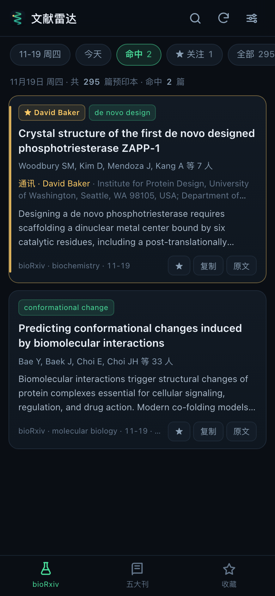
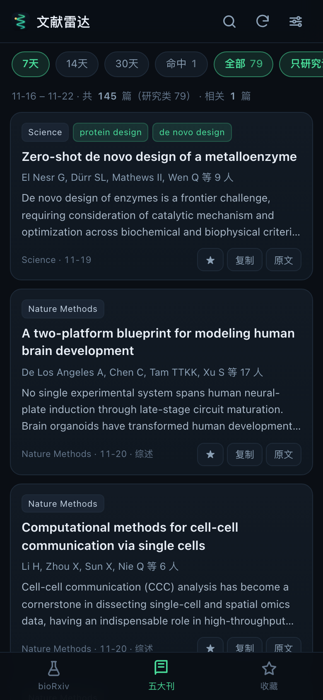
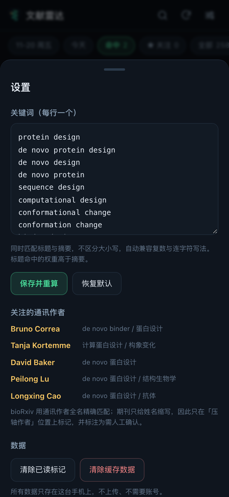

# 文献雷达 · 蛋白设计

每天打开就能看到新文章的私人文献雷达。纯前端 PWA，不用服务器、不用注册、数据只存在你自己手机上。

**两个 Tab**

- **bioRxiv**：按天抓取全部预印本，用关键词筛出蛋白设计相关；通讯作者是关注 PI 的独立高亮置顶。
- **五大刊**：Nature / Science / Cell / Nature Methods / Nature Biotechnology 的新发文章，同样按关键词筛，可一键切换「全部」。

外加**收藏**（跨两个来源，离线可看）、**搜索**、**已读标记**、**一键复制引用**、**关键词自己改**。

<p align="center">
  
  
  
</p>

---

## 一、装到手机上（3 步）

1. 用手机浏览器打开部署好的网址（见下一节）。
2. 华为浏览器：右下角菜单 → **添加到桌面**；Chrome：菜单 → **安装应用 / 添加到主屏幕**。
3. 回到桌面，点图标，全屏运行，和 App 没区别。

> 鸿蒙 4.2 直接可用。以后升级到 HarmonyOS NEXT 也照样能用——这正是选 PWA 而不是 APK 的原因。

---

## 二、部署到 GitHub Pages

### 方式 A：网页上传（不用装任何工具）

```bash
./build.sh          # 生成 dist/ 目录
```

1. 打开 <https://github.com/new>，仓库名填 `paper-hunt`，选 **Public**，创建。
2. 在新仓库页点 **uploading an existing file**，把 `dist/` **里面的内容**（不是 dist 文件夹本身）拖进去，提交。
3. 进入 Settings → Pages → Source 选 **Deploy from a branch** → 分支 `main`、目录 `/ (root)` → Save。
4. 等 1–2 分钟，访问 `https://<你的用户名>.github.io/paper-hunt/`。

### 方式 B：命令行

```bash
./build.sh
cd dist
git init -b main
git add -A
git commit -m "init"
git remote add origin https://github.com/<你的用户名>/paper-hunt.git
git push -u origin main
```

之后在仓库 Settings → Pages 里开启即可。

### 本地先看看

```bash
python3 -m http.server 8765
# 打开 http://127.0.0.1:8765/
```

---

## 三、改成你自己的关注点

打开应用 → 右上角 ⚙️ → **关键词**，每行一个，保存后立刻重算（不用重新抓数据）。

- 匹配范围：标题 + 摘要
- 不区分大小写，自动兼容复数（`change` 也命中 `changes`）和连字符（`conformational-change`）
- 标题命中的权重高于摘要命中
- 「恢复默认」会填回内置词表

**加 / 改通讯作者**：直接在应用里操作 —— ⚙️ → 「关注的通讯作者」→ **+ 添加通讯作者**，或点某一行的「改」「删」。填完保存立刻重算，不用重新抓数据。

每行可以填：

| 字段 | 作用 |
|---|---|
| 姓名 | 完整写法最准，如 `David Baker` |
| 别名 | 论文里出现的其他署名，每行一个，如 `Baker D` |
| 机构关键词 | 用来排除重名，逗号分隔，如 `University of Washington, HHMI` |
| 研究方向 | 仅用于界面显示 |
| 姓氏很常见 | 勾上后只在「压轴作者」位置才认定（Baker / Lu / Cao 这类建议勾） |

**姓名写法兼容**：系统会自动把姓名展开成几种形式去匹配，以下这些都能命中同一个人 ——

```
David Baker
Baker, David
Baker D
D. Baker
```
中文姓名的反序写法（`Lu Peilong`）也认，但只在短名字里启用，避免 `Sarah Baker, David Smith` 这种多人串被误判。

高级用法：也可以直接改 `js/config.js` 里的 `DEFAULT_PIS`（会作为「恢复默认」的内容）。

```js
{
  name: 'Peilong Lu',
  first: 'peilong',      // bioRxiv 通讯作者全名精确匹配用
  last: 'lu',
  initials: 'P',         // 期刊作者串只有缩写时用
  inst: ['westlake'],    // 机构佐证，降低重名误判
  field: 'de novo 蛋白设计 / 结构生物学',
  ambiguous: true,       // 姓氏重名风险高：只在压轴作者位置才认
}
```

**加期刊**：改 `js/config.js` 里的 `JOURNALS`，`match` 是用于归一刊名的正则。

---

## 四、它为什么不需要服务器

| 数据源 | 接口 | 跨域 |
|---|---|---|
| bioRxiv 预印本 | `api.biorxiv.org/details/biorxiv/{起}/{止}/{cursor}` | `Access-Control-Allow-Origin: *` |
| 五大刊 | `europepmc.org/webservices/rest/search?query=JOURNAL:"Nature" AND FIRST_PDATE:[…]` | `Access-Control-Allow-Origin: *` |

两个接口都允许浏览器直连，所以整条链路可以完全跑在手机上：

1. bioRxiv 按天拉全量（单日约 250–350 篇），浏览器端按关键词过滤；
2. Europe PMC 按刊并行查询，一次拿到五大刊当周全部条目（含摘要）；
3. 原始结果存 IndexedDB，历史日期永久缓存、当天缓存 20 分钟，翻回昨天不用重新联网。

顺带一提：五大刊自己的 RSS **没有** CORS 头，浏览器读不了，所以这里没用 RSS 而走 Europe PMC——它同时覆盖了这五本刊，且能按日期精确过滤。

---

## 五、几个容易踩的坑，已经处理了

- **重名**：`Lu P` / `Cao L` / `Baker D` 在文献里全是高频缩写。bioRxiv 优先用全名匹配，缩写形式要机构对得上才算「认定」；期刊只给缩写，所以只有**压轴作者**位置才标，其余标成「可能 · 需人工确认」。
- **PDF 直达**：bioRxiv 卡片的 `PDF` 按钮直接打开 `.full.pdf`（同页路径 + `.full.pdf`），点开就是 PDF；右侧 `↗` 是原文页面。五大刊只有开放获取的才有 `PDF`，订阅文章仍给原文页。
- **反序姓名**：`Baker, David` 这种写法单独识别，但 `Sarah Baker, David Smith` 不会被误判成 David Baker。
- **去重**：bioRxiv 的 v1/v2 按 DOI 只保留最新版本。
- **子刊污染**：Europe PMC 的 `JOURNAL:"Cell"` 有时会带出 `Cell Reports` 之类，这里按刊名精确归一后再过滤。
- **编辑部内容**：五大刊默认开着「只研究论文」，社论/新闻/勘误会被折叠，数量在筛选条上如实显示。

---

## 六、已知限制

- 不能主动推送。华为的后台策略会冻结第三方定时任务，网页推送也不可靠，所以定位是「每天自己点开」。真想要推送，得配一台常开机器跑定时任务发邮件。
- bioRxiv 只按**发布日**索引，周中更新多、周末基本没有；「今天」没数据时会自动回落到最近的更新日并提示。
- 关键词过滤是"字面匹配"，不做语义理解。想更准就自己加词，比如把 `binder design`、`RFdiffusion`、`miniprotein` 加进去。
- **五大刊首次加载偏慢**：Europe PMC 对没被查询过的日期区间要做 15–35 秒的冷查询，之后命中它自己的缓存约 6 秒。已经做了三件事——按刊并发、逐刊渐进渲染（哪个刊先回来先显示）、结果缓存 2 小时。所以每天只有第一次打开要等，其余时候是秒开。
- bioRxiv 首次加载需要联网 10–15 秒抓当天全量预印本，之后永久缓存。

---

## 七、改完代码怎么生效

Service Worker 会把静态资源缓存住，**第一次刷新拿到的可能还是旧版本**，再刷一次才更新。要主动让所有设备更新，把 `sw.js` 顶部的 `VERSION` 加一即可。

---

## 八、目录结构

```
index.html            页面骨架
styles.css            样式（深色、移动优先）
app.js                状态与交互
js/config.js          期刊、PI、默认关键词 —— 改这里
js/utils.js           日期、文本清洗、fetch 封装
js/store.js           IndexedDB 缓存 + localStorage 状态
js/api.js             bioRxiv / Europe PMC 抓取与归一
js/match.js           关键词匹配 + PI 识别
sw.js                 Service Worker（离线壳）
manifest.webmanifest  PWA 清单
icons/                图标
scripts/check.mjs     数据层自检（打真实接口）
scripts/probe.mjs     无头 Chrome 抓异常 + 截图
build.sh              打包 dist/
```
